# ADR-001: Nachrichtenpriorität, Slot-Negotiation und Logging-Verbesserungen

**Status:** Vorschläge A, C, D implementiert (seit v4.35p, upstream PR #806/#809/#816, März 2026). Vorschlag B nicht umgesetzt, in der hier beschriebenen Form nicht abwärtskompatibel (siehe 5.3).

**Datum:** 2026-03-15 (Entwurf), überarbeitet 2026-10-12 (Abgleich mit Codestand v4.40a)

**Autoren:** Martin DK5EN

**Kontext:** MeshCom Firmware v4.35p bis v4.40a

### Implementierungsstatus

| Vorschlag               | Status          | Seit   | Anmerkung                                                                                                                                                |
| ----------------------- | --------------- | ------ | -------------------------------------------------------------------------------------------------------------------------------------------------------- |
| **A: Priority-Queue**   | Implementiert   | v4.35p | 5 Stufen, Prio-Entnahme, Prio-CSMA, Prio-Drop. Seither erweitert, siehe Abschnitt 0                                                                      |
| **B: Slot-Negotiation** | Nicht umgesetzt | —      | Slot-Byte würde alte Firmware vom Empfang aussperren (5.3). Relay-Entlastung wird stattdessen über `docs/adr-nc-importance-backoff.md` (ADR-02) verfolgt |
| **C: Trickle-HEY**      | Implementiert   | v4.35p | ESP32 + nRF52. Feldmessung 2026-03-18: im Mittel 53 % weniger eigene HEYs (`docs/hey-supp.md`)                                                           |
| **D: Logging & HWM**    | Implementiert   | v4.35p | [MC-STAT], [MC-PRIO], [MC-HWM], [MC-TRICKLE]. Tatsächliche Formate siehe 7.2                                                                             |

> **Lesehinweis:** Die Abschnitte 1-12 sind der Entwurf vom März 2026. Wo der Code davon abweicht, ist das im Text mit **Stand v4.40a** markiert. Abschnitt 0 fasst den aktuellen Stand zusammen.

---

## 0. Aktueller Stand (v4.40a, 2026-10)

Was seit Phase 1 dazugekommen oder anders gelöst ist:

| Thema             | Stand v4.40a                                                                                                                                                                                                                        | Ort im Code                                              |
| ----------------- | ----------------------------------------------------------------------------------------------------------------------------------------------------------------------------------------------------------------------------------- | -------------------------------------------------------- |
| Ring-Code         | Prio-Zuweisung, Prio-Entnahme und Drop-Strategie liegen nicht mehr in `lora_functions.cpp`, sondern in einer eigenen Datei                                                                                                          | `src/txring_functions.cpp/.h`                            |
| Ringgröße         | `MAX_RING` = 20 auf allen Boards (Classic-ESP32 war 30, MEM-01), 10 im `ENABLE_TBEAM`-Dev-Build                                                                                                                                     | `src/configuration_global.h`                             |
| HEY-Alterung      | Prio-5-Einträge (HEY, auch HN-Nachbarschaftsmeldungen) werden nach 3 Minuten ungesendet verworfen (`RING_BG_MAX_AGE_MS`, BP-03), Log `RING_DROP_STALE`                                                                              | `txRingAgeBackground()` in `txring_functions.cpp`        |
| Send-once-Texte   | Eigene Texte ohne Wiederholung (z.B. {ping}, {CET}/{MCP}/{SET}, Beacon) werden als eigene Nachricht klassifiziert und erst danach auf DONE gesetzt, damit sie nicht als Relay (Prio 3) gelten                                       | `addTxRingEntryOnce()`                                   |
| Gateway-HEY       | Ein Gateway unterdrückt seinen HEY nie, wenn sein letzter eigener HEY ≥ Imax (15 min) her ist (F6)                                                                                                                                  | `heyShouldSuppress()` in `src/hey_policy.h`              |
| Trickle-Reset     | Topologieänderung = geänderte Zahl direkter Nachbarn aus der Nachbarschaftsmatrix (`nbrNcnt()`), nicht mehr MHeard                                                                                                                  | `esp32_main.cpp`, `nrf52_main.cpp`                       |
| NBR-Relay-Backoff | Optional (`--nbrrelay on`): Relays, die als einzige einen Nachbarn erreichen (Fall A), bekommen 3500 ms Basis; redundante POS/HEY-Relays (Fall B) werden bis zu 20 s zurückgehalten und bei gehörter fremder Wiederholung verworfen | `txringCaseBackoffSlot()`, `csma_compute_timeout_slot()` |
| PN-Wiederholung   | Wiederholungen einer DM tragen eine XOR-veränderte msg-id                                                                                                                                                                           | `src/pn_retry.h`                                         |

---

## 1. Zusammenfassung

Dieses ADR beschreibt vier zusammenhängende Verbesserungsvorschläge für die MeshCom-Firmware:

1. **Nachrichtenpriorität** — Lokale Priorisierung der TX-Queue + differenzierter CSMA-Backoff
2. **Slot-Negotiation als Fast-Lane** — Hybrid TDMA/CSMA: Slot-Info in **jedem** Paket, nicht nur HEY
3. **Adaptive HEY-Frequenz** — Trickle-Algorithmus zur Reduktion von Beacon-Overhead
4. **Logging & High-Water-Marks** — Erweiterung von `serial_monitor.py` und `loganalyse.sh`

**Leitprinzip: Mischbetrieb über Jahre.** Neue Firmware ist schneller, alte Firmware funktioniert weiter. Kein Node wird ausgesperrt. Wer updatet, profitiert sofort — und motiviert dadurch andere zum Update.

---

## 2. Problemstellung

### 2.1 Ist-Zustand (aus Loganalysen vom 13.-14. März 2026)

Die Alpine-Gateway-Analyse von 5 Bergstationen über 60+ Stunden zeigt:

| Metrik                     | Wert        | Bewertung              |
| -------------------------- | ----------- | ---------------------- |
| Direkt gehörte Nodes (H00) | 85-124      | Sehr dicht             |
| CAD-Busy-Rate (Berg)       | 50-80%      | Nahe Sättigung         |
| Duplikat-/Relay-Anteil     | 50-67%      | Enormer Overhead       |
| CRC-Fehlerrate             | 15-53%      | Hidden-Node-Problem    |
| TX-Queue Auslastung (max)  | 12/30 (40%) | Kein Überlauf          |
| ACK-Erfolgsrate            | 15-97%      | Stark standortabhängig |

### 2.2 Kernproblem

```
Die TX-Queue läuft selten über — aber wenn ein Nutzer eine DM sendet,
steht diese hinter 5-10 Relay/HEY-Paketen in der FIFO-Warteschlange.
Jedes Paket wartet 2-5 Sekunden auf CSMA-Freigabe.
Ergebnis: 10-50 Sekunden unnötige Verzögerung für menschliche Nachrichten.
```

### 2.3 Code vor Phase 1 (alter Ist-Zustand)

- **Ein einziger Ring-Buffer** (`ringBuffer[MAX_RING]`) mit FIFO-Verarbeitung
- **Kein Prioritätskonzept** — alle Nachrichtentypen werden gleich behandelt
- **Retry für alle eigenen Texte** (0x3A, Status 0x00, max 3 Wiederholungen im 40-s-Takt). Eine persönliche DM wird durch das `:ack` des Ziels gestoppt, Gruppen- und Broadcast-Texte durch das erste gehörte Echo (Relay eines Nachbarn). Nur der Fehlschlag wird ausschließlich für DMs an App/GUI gemeldet
- **Kein ACK für Gruppen und Broadcast "\*"** — sie bekommen keine Empfangsbestätigung vom Ziel
- **CSMA-Backoff** identisch für alle Nachrichtentypen (4500ms/3000ms/2000ms)
- **HEY-Frames** tragen nur Nachbarzahl (`;NCOUNT;`), keine Slot-Info

### 2.3a Code nach Phase 1 (v4.35p, Stand v4.40a ergänzt)

- **Gleicher Ring-Buffer** + paralleles `ringPriority[MAX_RING]` Array (1 Byte pro Slot, bei `MAX_RING` = 20 also 20 Bytes)
- **5 Prioritätsstufen** — ACK/DM (Prio 1) bis HEY (Prio 5)
- **Prio-Erkennung** via `getMessagePriority()`: msg_type, RING_STATUS_DONE (Relay), CheckGroup(dest), Ziel `*`
- **Prio-Entnahme** via `getNextTxSlot()`: scannt Ring-Buffer, waehlt hoechste Prio (FIFO bei gleicher Prio)
- **Prio-CSMA-Backoff**: 3000ms (ACK/DM/Gruppe) bis 5500ms (POS/HEY), statt einheitlich 4500ms
- **Prio-Drop**: bei voller Queue wird niedrigste Prio verworfen; neues Paket nur eingefuegt wenn hoehere Prio
- **Trickle-HEY**: adaptives Intervall 30s–15min (RFC 6206 adaptiert), Unterdrückung wenn im Intervall >=2 neue HEY-Frames empfangen wurden
- **Latenz-Tracking**: `ringEnqueueTime[MAX_RING]`, Statistik pro Prio alle 5 Min
- **Kein On-Air-Change** — alte Firmware empfaengt alle Pakete korrekt

**Stand v4.40a:** Neben `ringPriority[]` und `ringEnqueueTime[]` (4 Bytes pro Slot) führt der Ring weitere Parallel-Arrays (`ringSource`, `ringKind`, `ringNeed`, `ringAlone` für die Nachbarschaftsmatrix, `retryCount`). Der RAM-Aufwand der Prio-Logik allein bleibt klein, der gesamte Ring-Overhead liegt aber deutlich über den ursprünglich genannten 30 Bytes.

### 2.4 Nachrichtentypen im Code (aus Analyse)

| Typ               | Code | Ziel                     | ACK/Retry                           | Beispiel                                                           |
| ----------------- | ---- | ------------------------ | ----------------------------------- | ------------------------------------------------------------------ |
| Persönliche DM    | 0x3A | Callsign (z.B. `OE1ABC`) | ACK vom Ziel, Retry 3x/40s          | `OE1KBC>OE1ABC:Hallo{123`                                          |
| Gruppen-Nachricht | 0x3A | Nummer (z.B. `20`)       | Kein ACK, Retry bis zum ersten Echo | `OE1KBC>20:Info`                                                   |
| Broadcast "*"     | 0x3A | `*`                      | Kein ACK, Retry bis zum ersten Echo | `OE1KBC>*:CQ`                                                      |
| Position          | 0x21 | —                        | Nein                                | GPS-Beacon                                                         |
| HEY               | 0x40 | —                        | Nein                                | Neighbour-Discovery, auch HN-Nachbarschaftsmeldung                 |
| ACK               | 0x41 | —                        | Nein                                | Empfangsbestätigung (DM-ACKs laufen zusätzlich als Text `:ackNNN`) |

**Entscheidende Erkenntnis:** Alle Texttypen (DM, Gruppe, Broadcast) nutzen denselben MSG_TYPE 0x3A. Die Unterscheidung erfolgt über das Zielfeld (`CheckGroup()` und das `bDM`-Flag in `sendMessage()`, `loop_functions.cpp`: DM = keine Gruppe, nicht `*`, nicht `WLNK-1`, nicht `APRS2SOTA`).

---

## 3. Nachrichtentypen und Prioritätsklassen

### 3.1 Prioritätsmatrix

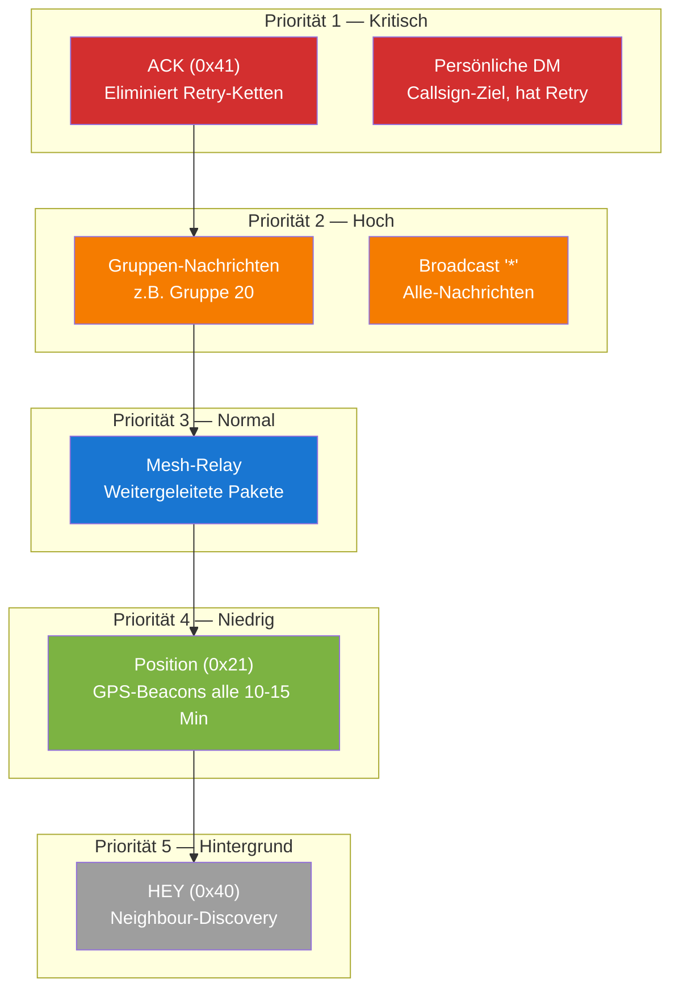

### 3.2 Begründung der Reihenfolge

| Prio | Typ                     | Begründung                                                                                          |
| ---- | ----------------------- | --------------------------------------------------------------------------------------------------- |
| 1    | ACK                     | Ein verlorener ACK erzeugt bis zu 3 Retransmits = 3x mehr Airtime. ACK-Prio spart Kanal.            |
| 1    | Persönliche DM          | Menschlich erzeugt, zeitkritisch, höchster Informationswert. Hat Retry-Mechanismus.                 |
| 2    | Gruppen + Broadcast "*" | Zweithäufigste Nutzerinteraktion. Fire-and-forget, daher wichtig dass sie beim ersten Mal ankommen. |
| 3    | Mesh-Relay              | Wichtig für Netzabdeckung, aber ein verpasstes Relay wird oft von anderem Node übernommen.          |
| 4    | Position                | Periodisch (10-15 Min), nächstes Update kommt automatisch.                                          |
| 5    | HEY                     | Höchste Frequenz, niedrigster Informationswert pro Paket.                                           |

### 3.3 Prio-Erkennung im Code

```
Pseudo-Code für Prio-Zuweisung:

function getPriority(ringSlot):
    type = ringBuffer[slot][2]

    if type == MSG_TYPE_ACK:        return PRIO_1
    if type == MSG_TYPE_POSITION:   return PRIO_4
    if type == MSG_TYPE_HEY:        return PRIO_5

    if type == MSG_TYPE_TEXT:
        if isRelay(slot):           return PRIO_3
        dest = parseDestination(slot)
        if CheckGroup(dest) != 0:   return PRIO_2   // Gruppe
        if dest == "*":             return PRIO_2   // Broadcast
        return PRIO_1                                // Persönliche DM
```

**Stand v4.40a** (`getMessagePriority()` in `txring_functions.cpp`):

- `isRelay` heißt im Code: Slot-Status beim Einreihen ist `RING_STATUS_DONE` (0xFF). Jeder Text, der mit DONE eingereiht wird, gilt als Relay (Prio 3), z.B. eine DM oder Gruppennachricht, die vom Server (UDP) auf LoRa gegeben wird. Eigene Send-once-Texte gehen deshalb über `addTxRingEntryOnce()`.
- Weitergeleitete ACK-Frames (0x41) bleiben Prio 1. Ein weitergeleitetes `:ack` als Text ist Prio 3.
- `WLNK-1` und `APRS2SOTA` als Ziel ergeben Prio 1, obwohl `bDM` für sie false ist.
- Ziel nicht lesbar: Prio 2. Unbekannter Typ: Prio 3.

---

## 4. Vorschlag A: Lokale Priority-Queue

### 4.1 Architektur

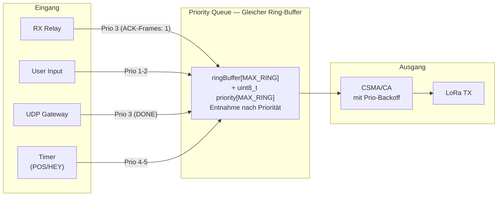

### 4.2 Implementierungsdetails

**Minimale Änderung am bestehenden Ring-Buffer:**

Der bestehende `ringBuffer[MAX_RING]` bleibt unverändert. Neu kommt ein paralleles Array:

```c
uint8_t ringPriority[MAX_RING];   // Prio 1-5 pro Slot
```

Die Entnahme-Logik in `getNextTxSlot()` (`txring_functions.cpp`) ändert sich von FIFO (`iRead++`) zu:

```
Pseudo-Code:

function getNextTxSlot():
    best_slot = -1
    best_prio = 255

    for slot = iRead .. iWrite (in Ring-Reihenfolge):
        if status in (RING_STATUS_READY, RING_STATUS_DONE):   // SENT und EXT_PENDING nie
            if ringPriority[slot] < best_prio:                // strikt kleiner:
                best_prio = ringPriority[slot]                 // bei gleicher Prio gewinnt
                best_slot = slot                               // der ältere (FIFO innerhalb Prio)

    return best_slot   // -1 wenn nichts zu senden
```

**Stand v4.40a:** Mit `--nbrrelay on` verliert ein Relay, das im Fall-B-Halt steht, gegen jeden nicht gehaltenen Slot. Gewählt wird es nur, wenn alle Kandidaten gehalten sind.

**RAM-Aufwand:** ein `uint8_t` pro Slot (heute 20 Bytes bei `MAX_RING` = 20). Kein zusätzlicher Buffer nötig.

### 4.3 Differenzierter CSMA-Backoff

Höhere Priorität = kürzerer Backoff = schnellerer Kanalzugriff:

| Prio         | Base-Timeout | Slot-Range         | Effektive Wartezeit |
| ------------ | ------------ | ------------------ | ------------------- |
| 1 (ACK/DM)   | 3000 ms      | 0-10 Slots (350ms) | 3.0 - 3.35s         |
| 2 (Gruppe/*) | 3000 ms      | 0-10 Slots (350ms) | 3.0 - 3.35s         |
| 3 (Relay)    | 4500 ms      | 0-10 Slots (350ms) | 4.5 - 4.85s         |
| 4 (POS)      | 5500 ms      | 0-10 Slots (350ms) | 5.5 - 5.85s         |
| 5 (HEY)      | 5500 ms      | 0-10 Slots (350ms) | 5.5 - 5.85s         |

Die Tabelle gilt für den ersten CAD-Versuch (Slot = 35 ms). Ist der Kanal belegt, sinkt die Basis auf 5/6 (Versuch 1) und 2/3 (Versuch 2), also z.B. 3000/2500/2000 ms für Prio 1. Ab Versuch 3 (`CSMA_MAX_ATTEMPTS`) folgt Rapid-fire-CAD mit 100 ms Preamble-Fenster, unabhängig von der Priorität.

Prio 1 und 2 sowie Prio 4 und 5 teilen sich jeweils dasselbe Zeitfenster. Die Backoff-Bereiche trennen also drei Gruppen, nicht fünf. Innerhalb einer Gruppe entscheidet nur die Entnahme-Reihenfolge.

**Stand v4.40a, `--nbrrelay on`:** Für Relays überschreibt der NBR-Fall den Prio-Backoff. Fall A (dieser Node erreicht einen Nachbarn als einziger): 3500 ms + 0-2 Slots, nach 8 s Wartezeit seit Einreihen nur noch eine Kurzsuche. Fall B (alle Nachbarn werden auch von anderen erreicht), nur POS/HEY: einmaliger Halt bis 20 s ab Einreihen, danach Prio-Basis + Slots 7-9. Fall-B-Texte behalten den normalen Prio-Backoff.

### 4.4 Koexistenz mit alter Firmware

**Verhalten der alten Firmware (Releases bis v4.34):**

Die Dev-Firmware vor Phase 1 hatte bereits CAD (`scanChannel()`). Die folgende Beschreibung gilt für ältere Releases bis v4.34, die im Feld noch laufen. Die alte Firmware hat **kein CAD** (Channel Activity Detection). Ihr TX-Mechanismus ist ein einfacher Timer:

1. Nach jedem empfangenen Paket: `iReceiveTimeOutTime = millis()`
2. Warte `RECEIVE_TIMEOUT` (4500ms) ohne neues Paket
3. Nach 4.5s: `iReceiveTimeOutTime = 0` → TX-Gate öffnet sich
4. **Blind senden** — kein CAD-Scan, keine Prüfung ob Kanal frei ist
5. **Harter Abbruch:** Wenn während des 4.5s-Timers ein Paket empfangen wird, wird der Timer zurückgesetzt. Aber wenn der Timer abläuft und gerade ein fremdes Paket auf dem Kanal liegt, wird der laufende Empfang abgebrochen (`radio.startReceive()` resettet den Receiver).

```
// TX-Gate der Releases bis v4.34 (esp32_main.cpp):
if(iReceiveTimeOutTime == 0 && !bEnableInterruptTransmit)
{
    // "channel is free" ← FALSCH: kein CAD, nur Timer = 0
    if (iWrite != iRead)
    {
        doTX();  // Blind senden!
    }
}
```

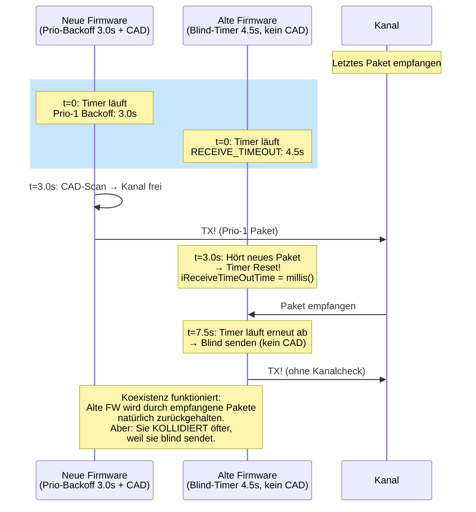

**Koexistenz-Analyse:**

| Szenario                             | Verhalten                                               | Risiko                                      |
| ------------------------------------ | ------------------------------------------------------- | ------------------------------------------- |
| Neue FW sendet während alte wartet   | Alte FW hört Paket → Timer-Reset → wartet nochmal 4.5s  | Kein Problem                                |
| Alte FW Timer läuft ab, Kanal belegt | Alte FW sendet blind → **Kollision!**                   | Wie bisher — alte FW kollidiert heute schon |
| Beide Timer laufen gleichzeitig ab   | Neue FW sendet nach 3.0s, alte nach 4.5s → zeitversetzt | Neue FW ist 1.5s früher dran                |
| Kanal leer, beide wollen senden      | Neue FW gewinnt immer (kürzerer Timeout)                | Korrekt — Update-Anreiz                     |

**Wichtig:** Die alte Firmware wird **nicht schlechter** als heute. Sie kollidiert heute schon blind — das ändert sich nicht. Die neue Firmware ist einfach **schneller und sicherer dran** dank CAD + kurzerem Prio-Backoff. Das ist ein natürlicher Anreiz zum Update, ohne alte Nodes auszusperren.

### 4.5 Drop-Strategie bei voller Queue

**Regel:** Wenn die Queue voll ist, wird der älteste Eintrag der **niedrigsten belegten Priorität** verworfen.

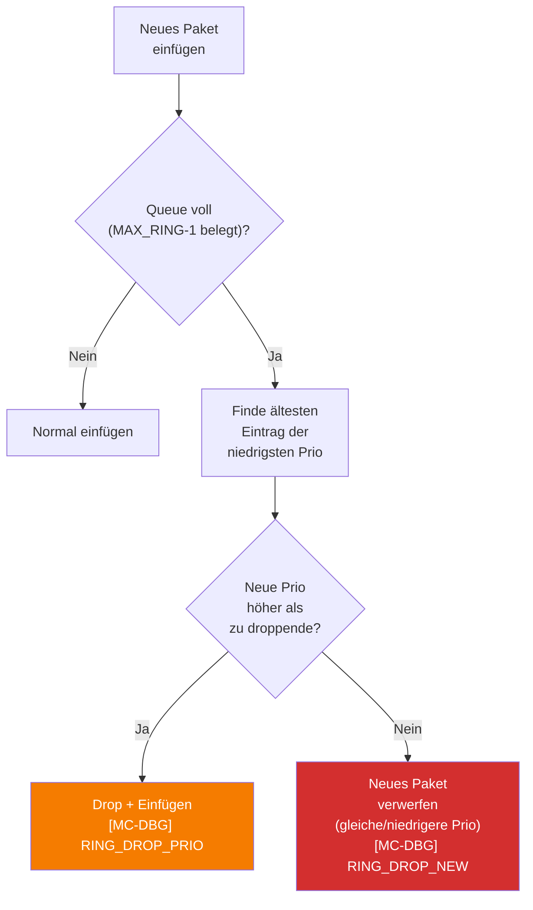

Ein HEY wird vor einem POS gedroppt, ein POS vor einem Relay. ACKs und DMs werden **nie** zugunsten niedrigerer Pakete verworfen.

**Stand v4.40a** (`addTxRingEntry()` in `txring_functions.cpp`):

- Liegt das Opfer nicht an `iRead`, wird der Eintrag an `iRead` in den frei gewordenen Slot verschoben (N-24). Er verliert dabei seinen FIFO-Rang innerhalb seiner Priorität.
- `EXT_PENDING`-Slots (externes Radio) werden nie verdrängt.
- ACKs und DMs können trotzdem verloren gehen: Ist der Ring nur mit Prio-1-Einträgen voll, wird eine neue DM abgewiesen (`RING_DROP_NEW`). Nach 3 Wiederholungen ohne ACK gibt der Retry auf. Ein Node mit Werks-Rufzeichen sendet nicht (TX-01).
- Unabhängig vom Füllstand verwirft `txRingAgeBackground()` Prio-5-Einträge, die älter als 3 Minuten sind (`RING_DROP_STALE`).

---

## 5. Vorschlag B: Slot-Negotiation als Fast-Lane (Hybrid TDMA/CSMA)

> **Review 2026-10: nicht umgesetzt, Entwurf mit bekannten Fehlern.** Der Abschnitt bleibt als Entscheidungsgrundlage stehen. Vor einer Umsetzung müssen diese Punkte gelöst sein:
>
> 1. **Abwärtskompatibilität (5.3) trifft nicht zu.** Ein zusätzliches Byte bricht den Empfang alter Firmware. Davor eingefügt (Index 0) erkennt `decodeAPRS()` den Nachrichtentyp nicht mehr. Hinter dem Header (Index 6) bricht die Rufzeichen-Suche bei jedem Byte > 0x7E ab (`aprs_functions.cpp`), das Paket wird als `[LORA-ERROR]` verworfen, weder angezeigt noch weitergeleitet. Das Netz zerfiele in alte und neue Nodes. Byte 5 (max_hop + Flags) hat keine freien Bits. Ein gangbarer Weg wäre, wie bei der PN-Wiederholung (`pn_retry.h`), freie Bits der msg-id zu nutzen.
> 2. **Bit-Layout (5.2) passt nicht in ein Byte.** Bits 6-4 fassen 0-7, nicht 0-15. Flag + 4 Bit Slot + 4 Bit Phase sind 9 Bit.
> 3. **2-s-Slot zu kurz (5.4).** Bei SF11/BW250/CR4/6 und 32 Symbolen Preamble dauert ein Paket mit 50 B 0,85 s, mit 126 B 1,5 s, mit 181 B 2,0 s und mit 255 B 2,7 s. Nur Pakete bis ca. 126 B passen in das 1,5-s-Budget.
> 4. **Drift (5.4/5.6).** Zwei Nodes können gegenläufig driften (bis 40 ppm relativ = 144 ms/h). Mit einem Sync-Fehler von ±100-200 ms ist die 200-ms-Guardtime bereits verbraucht. Die Empfangszeit liegt am Paketende, die Airtime (0,85-2,7 s) muss abgezogen werden.
> 5. **Phase (5.6) widersprüchlich.** "NTP-Sekunde MOD 60" (0-59) passt nicht in 4 Bit, `(millis()/2000) % 16` wiederholt sich alle 32 s statt 60 s und ist bootrelativ.

### 5.1 Grundidee

Nicht alle Nodes brauchen einen Slot — aber wer einen hat, darf **ohne CSMA-Wartezeit** senden. Das ist die "Fast-Lane". Alle anderen nutzen weiterhin CSMA.

### 5.2 Slot-Info in JEDEM Paket (nicht nur HEY)

**Jedes ausgehende Paket trägt Slot-Info** als Micro-Header.

**Problem mit HEY:** HEY kommt nur alle 15 Minuten. Slot-Konvergenz über HEY allein dauert 30+ Minuten.

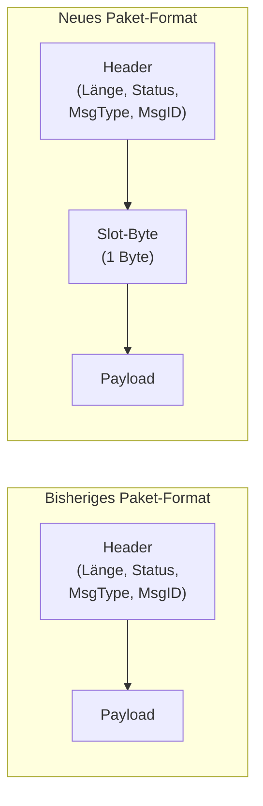

**Slot-Byte Aufbau (1 Byte):**

```
Bit 7:    Slot-Feature aktiv (1) oder nicht (0)
Bit 6-4:  Eigener Slot-Nummer (0-15, 0x7=kein Slot)
Bit 3-0:  Superframe-Phase (0-15, aktueller Zeitpunkt im Superframe)
```

**Warum nur 1 Byte statt Bitmap?**

- Jeder Node advertiert nur seinen EIGENEN Slot
- Die Bitmap wird lokal aus den empfangenen Slots aller Nachbarn aufgebaut
- Spart 2 Bytes pro Paket (bei 100+ Nodes und jedem Paket relevant)

### 5.3 Koexistenz: Slot-Byte und alte Firmware

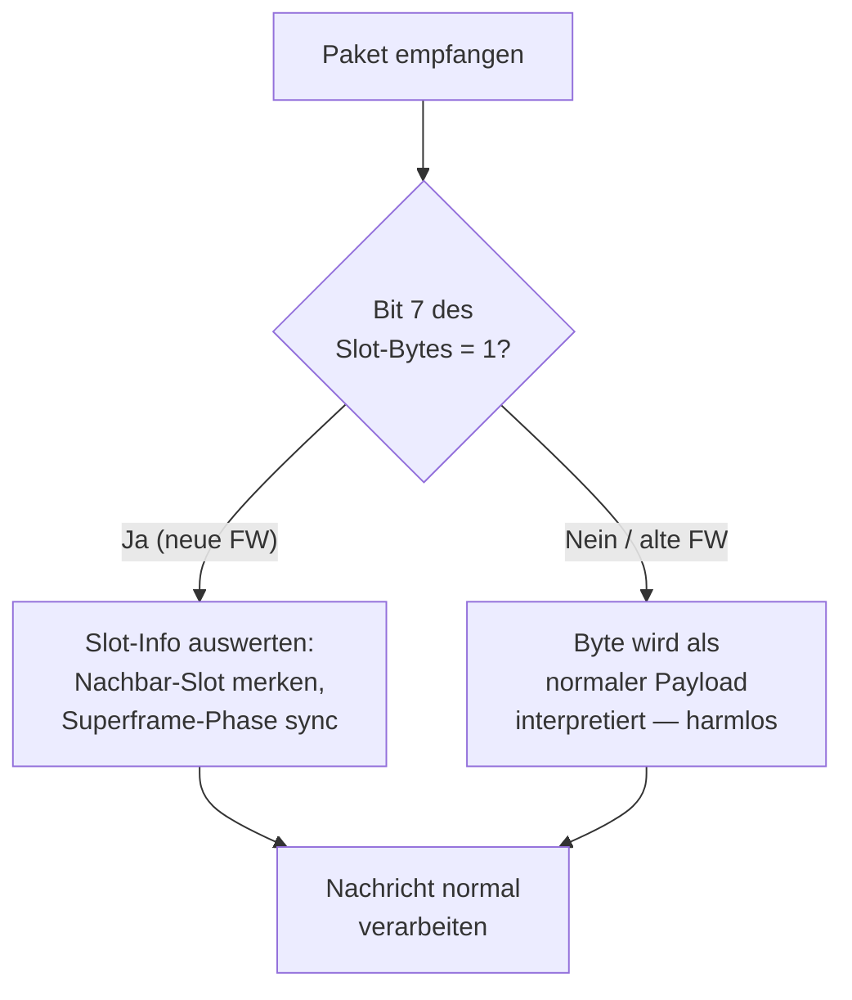

**Annahme des Entwurfs (widerlegt, siehe Review-Kasten oben):** ~~Alte Firmware sieht das Slot-Byte als Teil des Payloads und ignoriert es, weil es kein gültiges APRS-Zeichen ist.~~ **Tatsächlich:** `decodeAPRS()` verwirft das ganze Paket. Kein Crash, aber die Nachricht kommt bei alter Firmware nicht an und wird von ihr nicht weitergeleitet.

**Neue Firmware sendet an alte Firmware:** ~~Das Paket kommt an. Das Slot-Byte wird von alter Firmware ignoriert.~~ Das Paket geht verloren (siehe oben).

**Alte Firmware sendet an neue Firmware:** Kein Slot-Byte vorhanden (Bit 7 = 0 im ersten Payload-Byte). Neue Firmware erkennt: "Kein Slot-Feature" und verarbeitet normal.

### 5.4 Was ist ein Superframe — und warum brauchen wir einen?

#### Das Problem ohne Zeitstruktur

Wenn Node A Slot 3 beansprucht und Node B Slot 7 — woher wissen beide, _wann_ Slot 3 bzw. Slot 7 dran ist? Ohne gemeinsames Zeitraster sind Slot-Nummern bedeutungslos. Es braucht einen wiederkehrenden Zeitrahmen, in dem jeder Slot einen festen Platz hat. Diesen Rahmen nennt man **Superframe**.

#### Was ein Superframe NICHT ist

- **Keine Sendepause.** Kein Node wird am Senden gehindert.
- **Keine Änderung für alte Firmware.** Alte Nodes senden weiter wie bisher — sie wissen nichts vom Superframe.
- **Kein harter TDMA-Takt.** Der Superframe ist ein **Koordinationsangebot**, keine Pflicht.

#### Was ein Superframe IST

Ein Superframe ist eine **gedachte Zeiteinteilung**, die nur in den Köpfen der neuen Firmware existiert. Er teilt die laufende Zeit in wiederkehrende Abschnitte. Für alte Firmware ändert sich **gar nichts** — sie sendet weiterhin nach ihrem 4.5s-Blind-Timer, ohne etwas vom Superframe zu wissen.

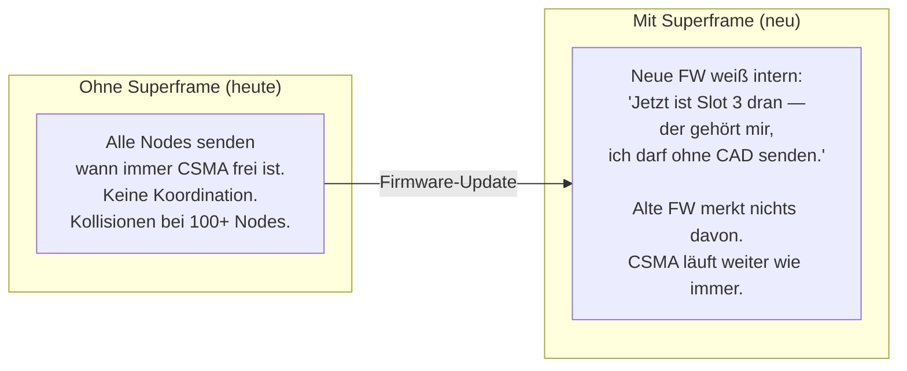

#### Herleitung der Zeitstruktur

Die Slot-Dauer ergibt sich direkt aus der Physik:

1. **LoRa-Paket-Airtime:** ca. 1.2–1.5 Sekunden bei MeshCom-Parametern (EU8: SF11, BW250, CR4/6). _Review: gilt nur für ca. 90-126 B. Volle Pakete (255 B) brauchen 2,7 s._
2. **Guardtime für Uhrendrift:** ESP32-Quarze driften ~20ppm = 1.2ms/Minute. Bei 200ms Guardtime kann ein Node >2 Stunden ohne Re-Sync arbeiten.
3. **Reserve:** 300ms für Verarbeitungszeit und TX-Umschaltung
4. **Ergebnis: 2 Sekunden pro Slot** (1.5s Airtime + 200ms Guard + 300ms Reserve)

Bei 16 Slots ergibt sich eine Slot-Phase von 32 Sekunden. Die restliche Zeit ist **offene CSMA-Phase** — genau wie heute, für alle Nodes, ohne Einschränkung.

```mermaid
gantt
    title Superframe (60 Sekunden) — wiederholt sich endlos
    dateFormat X
    axisFormat %s

    section Slot-Phase (32s) — Fast-Lane für Slot-Inhaber
    Slot 0 :s0, 0, 2
    Slot 1 :s1, 2, 4
    Slot 2 :s2, 4, 6
    Slot 3 :s3, 6, 8
    Slot 4 :s4, 8, 10
    Slot 5 :s5, 10, 12
    Slot 6 :s6, 12, 14
    Slot 7 :s7, 14, 16
    Slot 8 :s8, 16, 18
    Slot 9 :s9, 18, 20
    Slot 10 :s10, 20, 22
    Slot 11 :s11, 22, 24
    Slot 12 :s12, 24, 26
    Slot 13 :s13, 26, 28
    Slot 14 :s14, 28, 30
    Slot 15 :s15, 30, 32

    section CSMA-Phase (28s) — offen für alle, wie heute
    Freier CSMA-Zugriff für alle :csma, 32, 60
```

#### Wer darf wann senden?

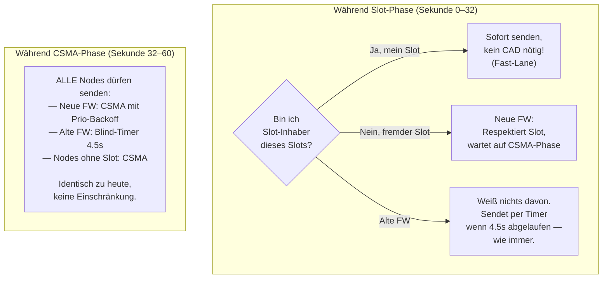

#### Warum verhungert niemand?

| Bedenken                                                     | Antwort                                                                                                                                                                                                                                                                                |
| ------------------------------------------------------------ | -------------------------------------------------------------------------------------------------------------------------------------------------------------------------------------------------------------------------------------------------------------------------------------- |
| "Alte Firmware kann 32s lang nicht senden!"                  | **Falsch.** Alte FW kennt den Superframe nicht. Sie sendet wann immer ihr 4.5s-Timer abläuft — auch mitten in der Slot-Phase. Im schlimmsten Fall kollidiert sie mit einem Slot-Inhaber. Das ist **nicht schlimmer als heute**, wo sie ohnehin blind sendet und regelmäßig kollidiert. |
| "Neue FW ohne Slot darf 32s lang nicht senden!"              | **Falsch.** Sie darf per CSMA senden, auch während der Slot-Phase. Sie **respektiert nur den gerade aktiven 2s-Slot** eines Nachbarn und wartet maximal diese 2s ab. Die restlichen 30s der Slot-Phase sind frei.                                                                      |
| "28s CSMA-Phase ist weniger als 60s — also schlechter?"      | **Nein.** Heute gibt es gar keine Koordination — 60 Sekunden unkontrollierter Wettbewerb mit 100+ Nodes. Im neuen System: 32s wo nur wenige Nodes geordnet senden + 28s offener CSMA = **insgesamt weniger Kollisionen**, nicht mehr.                                                  |
| "Ein Node hat Slot, sendet aber nichts?"                     | Slot bleibt leer. Keine Airtime-Verschwendung. Der Slot ist ein **Recht**, keine Pflicht.                                                                                                                                                                                              |
| "Was wenn mein Slot genau dann kommt, wenn ich nichts habe?" | Kein Problem — nächste Chance in 60 Sekunden. Und in der CSMA-Phase (28s) darf der Node jederzeit senden. Der Slot ist ein _Bonus_, nicht der einzige Sendezeitpunkt.                                                                                                                  |

#### Parameter-Übersicht

| Parameter          | Wert        | Herleitung                                                                                            |
| ------------------ | ----------- | ----------------------------------------------------------------------------------------------------- |
| Superframe-Länge   | 60 Sekunden | Kurz genug für Mobilität, lang genug für 16 Slots + CSMA                                              |
| Slot-Dauer         | 2 Sekunden  | 1.5s LoRa-Airtime + 200ms Guard + 300ms Reserve                                                       |
| Slot-Anzahl        | 16          | Passt zu typischer Nachbarschaftsgröße. _Review: das Layout in 5.2 hat nur 3 Bit für die Slot-Nummer_ |
| CSMA-Phase         | 28 Sekunden | Offener Zugang für alle — alte FW, neue FW, slotlose Nodes                                            |
| Guardtime pro Slot | 200ms       | ESP32-Drift ~20ppm = 72ms/Stunde → >2h ohne Re-Sync                                                   |

### 5.5 Slot-Vergabe-Algorithmus

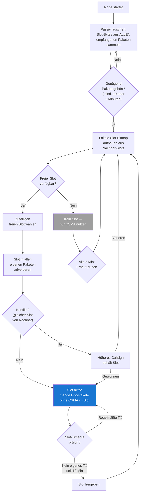

### 5.6 Synchronisation ohne GPS/NTP

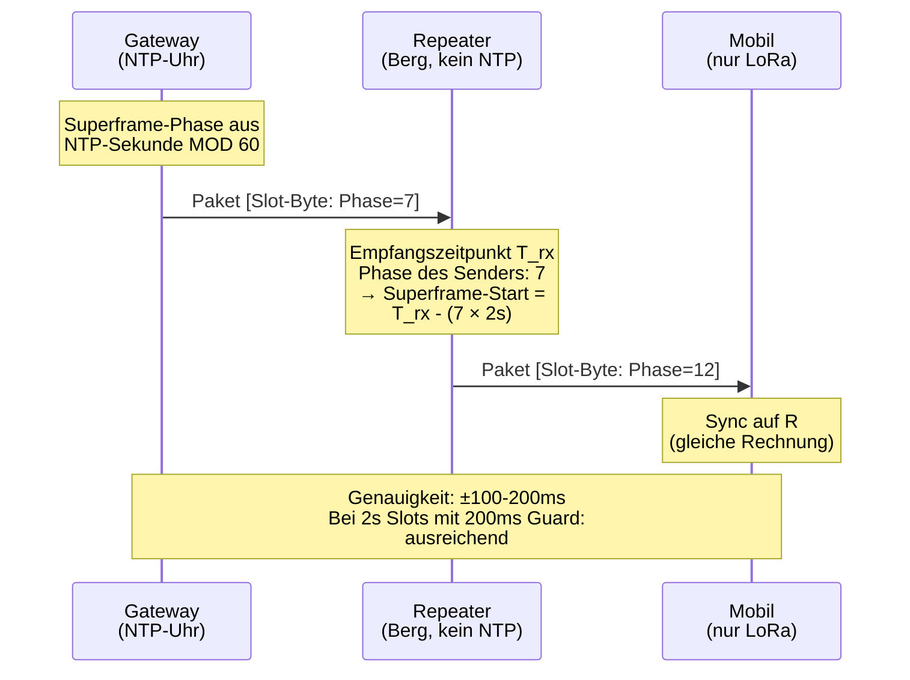

**Sync-Kette:**

1. **Gateways** (mit NTP/GPS) sind Zeitanker. Superframe-Phase = `(millis() / 2000) % 16`
2. **Repeater** synchronisieren auf den zuletzt gehörten Gateway
3. **Mobile Nodes** synchronisieren auf den zuletzt gehörten Repeater/Gateway
4. **Drift-Toleranz:** 200ms Guardtime pro Slot. ESP32-Quarze driften ~20ppm = 1.2ms/Minute = 72ms/Stunde. Selbst ohne Re-Sync bleibt die Drift unter der Guardtime für >2 Stunden.

### 5.7 Was passiert im Slot?

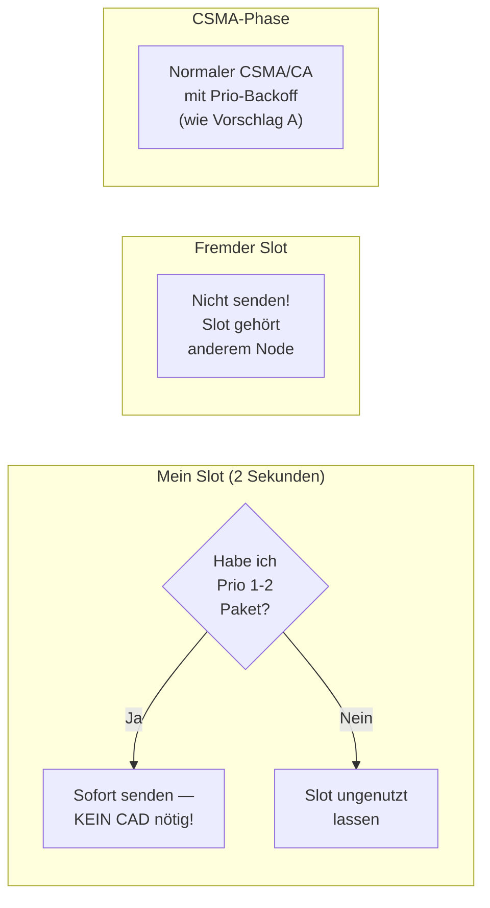

**Nur Prio 1-2 Pakete** (ACK, DM, Gruppen, Broadcast) nutzen den Slot. Prio 3-5 (Relay, POS, HEY) warten auf die CSMA-Phase. Damit ist die Fast-Lane für das reserviert, was den Nutzer interessiert.

### 5.8 Slot-Timeout: 10 Minuten reichen

Da die Slot-Info in **jedem** Paket steckt (nicht nur HEY), werden Nachbarn ständig über belegte Slots informiert. Ein Node, der 10 Minuten lang keinen Slot-Claim gehört hat, darf den Slot als frei betrachten.

| Szenario                      | Timeout-Verhalten                                 |
| ----------------------------- | ------------------------------------------------- |
| Node ausgeschaltet            | Nachbarn sehen 10 Min kein Paket → Slot frei      |
| Node außer Reichweite (mobil) | Gleich wie oben                                   |
| Node sendet selten (Idle)     | Eigener HEY alle 15 Min reicht als Keepalive      |
| Paket geht verloren           | Nächstes Paket (irgendein Typ) erneuert den Claim |

### 5.9 16 Slots für 100+ Nodes?

Nicht jeder Node braucht einen Slot. Die Fast-Lane ist ein **Premium-Feature:**

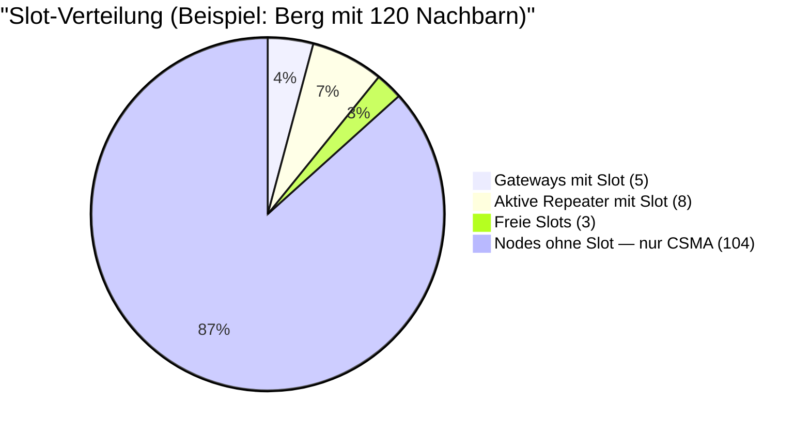

Nodes ohne Slot sind **nicht benachteiligt gegenüber dem Status Quo** — sie nutzen CSMA wie bisher. Die Fast-Lane ist ein Bonus für Nodes, die viel Nutzer-Traffic weiterleiten.

**Selbstregulierung:** Wenn ein Node 10 Minuten lang keinen Prio 1-2 Traffic hat, gibt er seinen Slot frei. Slots wandern automatisch zu den Nodes, die sie brauchen.

---

## 6. Vorschlag C: Adaptive HEY-Frequenz (Trickle-Algorithmus)

### 6.1 Motivation

Bei 100 Nodes mit HEY alle 15 Minuten: ~7 HEY/Minute = ein HEY alle 9 Sekunden. Das zählt nur selbst erzeugte HEYs. Relays vervielfachen die Zahl (in `docs/hey-supp.md` 776-1390 weitergeleitete HEYs gegen 9-26 eigene pro Node in 9,5 h). Bei 50-80% CAD-Busy ist das signifikanter Overhead für reinen Housekeeping-Traffic.

### 6.2 Trickle-Algorithmus (RFC 6206 adaptiert) für MeshCom

Umgesetzt ist eine vereinfachte Variante ohne Zustände und ohne den Zufallszeitpunkt t ∈ [I/2, I) aus RFC 6206. Am Ende jedes Intervalls wird genau einmal entschieden:

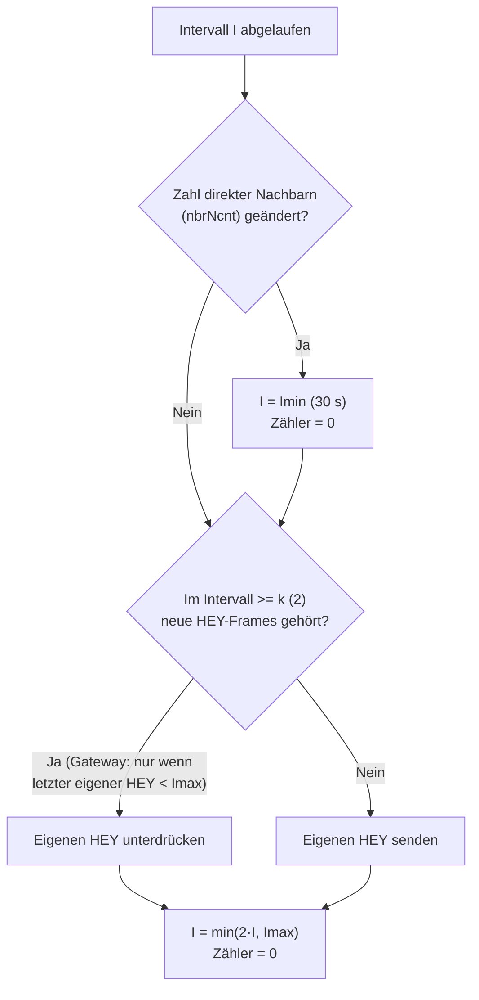

| Parameter             | Wert                                   | Bedeutung                                                                  |
| --------------------- | -------------------------------------- | -------------------------------------------------------------------------- |
| Imin                  | 30 Sekunden                            | Schnellster HEY-Intervall (nach Topologieänderung)                         |
| Imax                  | 15 Minuten                             | Langsamster HEY-Intervall (stabiles Netz, wie bisher)                      |
| k (Redundanzschwelle) | 2                                      | Unterdrücke eigenen HEY, wenn im Intervall >=2 HEY-Frames empfangen wurden |
| Verdopplung           | Pro Intervall, auch nach Unterdrückung | 30s -> 1m -> 2m -> 4m -> 8m -> 15m                                         |

**Stand v4.40a, Details aus dem Code:**

- **"Konsistent"** heißt: jeder neue (nicht doppelte) HEY-Frame, von jedem Absender, auch weitergeleitet. Inhalte werden nicht verglichen. HN-Nachbarschaftsmeldungen zählen nicht.
- **Topologieänderung** wird nur am Intervallende geprüft und nur als geänderte Zahl direkter Nachbarn (`nbrNcnt()`, Nachbarn der letzten 60 min). Ein Nachbar, der gegen einen anderen getauscht wird, löst keinen Reset aus. `--gateway on/off` setzt das Intervall ebenfalls auf Imin und sendet sofort einen HEY.
- **Gateway-Ausnahme (F6):** Ein Gateway unterdrückt nie, wenn sein letzter eigener HEY ≥ Imax alt ist. So geht mindestens ein HG pro 15 min raus (`heyShouldSuppress()`, `src/hey_policy.h`).
- **nRF52** nutzt dieselbe Entscheidungslogik. Es loggt nur `SUPPRESS`, nicht `SEND` und `TOPO_CHANGE`.
- **Kein Schalter:** Trickle lässt sich nicht abschalten. Mit `ENABLE_SOFTSER` (ESP32) kommen 10 min auf jedes Intervall.
- **HN-Nachbarschaftsmeldungen** (`--nbrreport`) laufen auf eigenem Takt (erste nach 5 min, dann alle 15 min + 0-30 s Jitter) und werden nie unterdrückt.
- **Alterung:** Ein HEY, der 3 min nicht gesendet werden konnte, wird aus dem Ring verworfen (`RING_BG_MAX_AGE_MS`).

**Erwartete Einsparung (Entwurf):** 60-70% weniger HEY-Traffic in stabilen Netzen. **Gemessen** (2026-03-18, 5 Gateway-Nodes, 9,5 h, `docs/hey-supp.md`): 29-75 %, im Mittel 53 % weniger eigene HEYs.

**Wichtig mit Slot-Feature (nicht umgesetzt):** Da Slot-Info in jedem Paket steckt, ist ein seltenerer HEY kein Problem für die Slot-Konvergenz. HEY bleibt für die Nachbarerkennung (MHeard) relevant, aber nicht mehr als einziger Slot-Träger.

---

## 7. Vorschlag D: Logging & High-Water-Marks

### 7.1 Bestehende Infrastruktur

MeshCom hat bereits hervorragende Monitoring-Tools:

| Tool                      | Zweck                                                      | Status                      |
| ------------------------- | ---------------------------------------------------------- | --------------------------- |
| `tools/serial_monitor.py` | Echtzeit-Monitoring: State-Machine, Alerts, 300s-Summaries | Vorhanden, gut              |
| `tools/loganalyse.sh`     | Batch-Analyse: 20+ Sektionen, CRC, CAD, Ring, Dedup, etc.  | Vorhanden, sehr umfangreich |

**Was fehlt:** Prioritäts-spezifische Metriken und Slot-Statistiken.

### 7.2 Firmware-Log-Zeilen (Stand v4.40a)

Der Entwurf sah reichere Zeilen vor (CAD-Busy, RX-Zähler, Latenz-Perzentile, OnRxDone- und ACK-Wartezeit-HWM). Implementiert sind die folgenden Formate. `[MC-STAT]`, `[MC-PRIO]` und `[MC-HWM]` gibt es nur auf ESP32.

**Alle 5 Minuten — Prioritäts-Statistik (nur mit `--loradebug on`):**

```
[MC-STAT] t=300s qmax=8/20
  tx: p1=3 p2=2 p3=45 p4=12 p5=8 preempt=3
  drop: p1=0 p2=0 p3=0 p4=0 p5=2
```

`qmax` ist der Höchststand seit Boot, nicht pro Fenster. `preempt` zählt Sendungen, bei denen nicht der Slot an `iRead` gewählt wurde.

**Alle 5 Minuten — Latenz pro Priorität (nur mit `--loradebug on`, nur Stufen mit Sendungen):**

```
[MC-PRIO] p1_lat_avg=2100ms p1_lat_max=4800ms p1_cnt=5
[MC-PRIO] p3_lat_avg=4800ms p3_lat_max=8400ms p3_cnt=45
```

Latenz = Einreihen bis Senden. `lat_max` sättigt bei 65535 ms.

**Alle 30 Minuten — High-Water-Marks (seit Boot, ohne Debug-Schalter, unterdrückt bei `--setlog on`):**

```
[MC-HWM] uptime=3600s queue_hwm=12/20 csma_hwm=23 trickle=900000ms
```

**Trickle (ESP32 mit `--loradebug on`; nRF52 nur `SUPPRESS`):**

```
[MC-TRICKLE] TOPO_CHANGE neighbors=5->6 interval_reset=30000ms
[MC-TRICKLE] SUPPRESS consistent=3>=k=2 interval=240000ms neighbors=6
[MC-TRICKLE] SEND consistent=1<k=2 interval=480000ms neighbors=6
```

**Ring-Drops (beide Plattformen, `--loradebug on`):**

```
[MC-DBG] RING_DROP_PRIO slot=4 prio=5 type=40 msg_id=... replaced_by_prio=1 src=...
[MC-DBG] RING_DROP_NEW ... (queue full, no lower prio to evict)
```

**Immer verfügbar (beide Plattformen, `--setlog on`):** Die `STAT`-Zeile (SL-05) enthält u.a. `ringmax=`, `drop=p1/../p5` und `trk=<Intervall_s>/<consistent>`.

**Bei Slot-Feature — Slot-Statistik (Entwurf, nicht implementiert):**

```
[MC-SLOT] window=300s
  own_slot=3 phase_drift_ms=45
  neighbors_with_slot=7/16
  slot_tx=4 slot_skip=12 csma_tx=67
  slot_collision=0 slot_timeout=1
```

### 7.3 Erweiterungen für serial_monitor.py

**Stand v4.40a:** Umgesetzt ist `PRIO1_STARVED` (feuert, wenn `p1_lat_max` in einer `[MC-PRIO]`-Zeile 10 s übersteigt) sowie eine Summary mit Trickle-Ereignissen (gesendet/unterdrückt/Topologie) und Prio-Drops. `SLOT_CONFLICT`, `QUEUE_INVERSION`, `SLOT_DRIFT` und Latenz-Perzentile gibt es nicht.

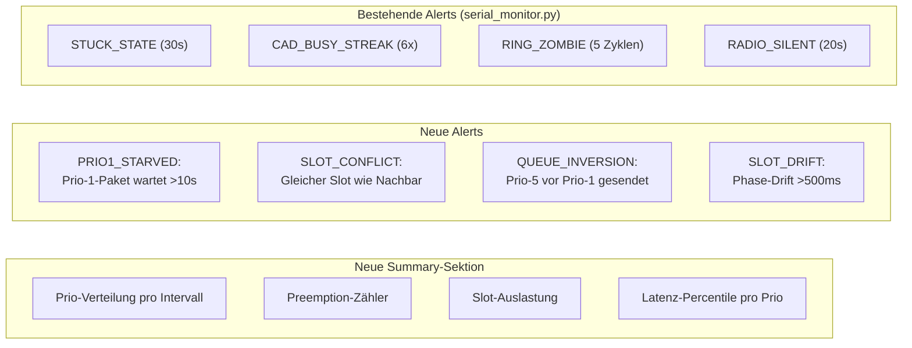

### 7.4 Erweiterungen für loganalyse.sh

**Stand v4.40a:** Umgesetzt sind `PRIORITY_DISTRIBUTION` (zeigt die letzten `[MC-STAT]`/`[MC-PRIO]`-Zeilen und Drops nach Prio und Typ, ohne Prozentrechnung), `TRICKLE_HEY` (gesendet/unterdrückt/Topologie) und `HIGH_WATER_MARKS`. `PRIORITY_LATENCY` und `SLOT_ANALYSIS` gibt es nicht. Auf nRF52-Logs zeigt `TRICKLE_HEY` 100 % Unterdrückung, weil dort nur `SUPPRESS` geloggt wird.

Entwurf der Sektionen:

```
=== PRIORITY_DISTRIBUTION ===
  Prio 1 (ACK/DM):   5.2% aller TX (avg 3.1/5min)
  Prio 2 (Grp/Bcast): 2.8% aller TX (avg 1.7/5min)
  Prio 3 (Relay):    68.4% aller TX (avg 41.2/5min)
  Prio 4 (POS):      15.3% aller TX (avg 9.2/5min)
  Prio 5 (HEY):       8.3% aller TX (avg 5.0/5min)

=== PRIORITY_LATENCY ===
  Prio 1: avg=2.1s  p50=1.8s  p95=4.8s  max=7.2s
  Prio 2: avg=3.2s  p50=2.9s  p95=5.1s  max=8.4s
  Prio 3: avg=4.8s  p50=4.5s  p95=8.4s  max=12.1s
  Prio 4: avg=5.2s  p50=5.0s  p95=9.1s  max=14.3s
  Prio 5: avg=5.8s  p50=5.5s  p95=11.2s max=18.7s

=== SLOT_ANALYSIS ===
  Slot-Nutzung: 7/16 belegt
  Slot-Kollisionen: 0
  Slot-TX vs CSMA-TX: 4 vs 67 (5.6%)
  Slot-Drift max: 45ms (OK, Guard=200ms)
```

---

## 8. Gesamtarchitektur

### 8.1 Zusammenspiel aller Vorschläge

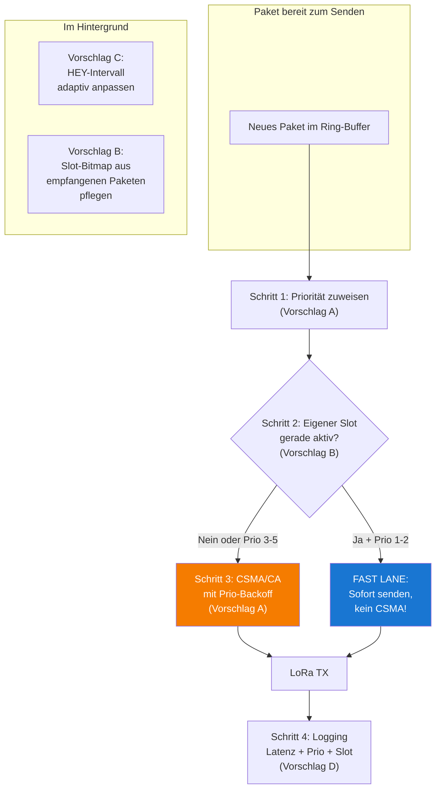

### 8.2 Mixed-Mode Übersicht

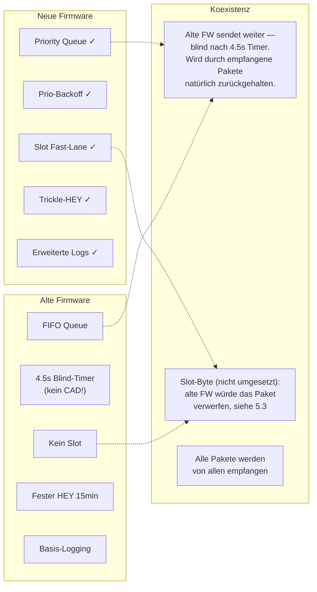

**Kein Node wird ausgesperrt** — das gilt für die umgesetzten Vorschläge A, C und D, die nichts am Paketformat ändern. Wer updated, profitiert sofort. Wer nicht updated, arbeitet wie bisher. Für Vorschlag B gilt es in der beschriebenen Form nicht (5.3).

---

## 9. Implementierungsplan

### 9.1 Phasen

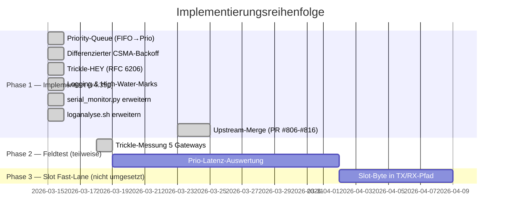

### 9.2 Phasen-Details

| Phase  | Beschreibung                                                   | Status                                                                               | On-Air                          | Risiko       |
| ------ | -------------------------------------------------------------- | ------------------------------------------------------------------------------------ | ------------------------------- | ------------ |
| **1a** | `ringPriority[MAX_RING]` + Prio-Entnahme via `getNextTxSlot()` | **Implementiert**                                                                    | Nein                            | Niedrig      |
| **1b** | Prio-abhaengige CSMA-Timeouts (3000–5500ms)                    | **Implementiert**                                                                    | Nein                            | Niedrig      |
| **1c** | Prio-Drop bei voller Queue (niedrigste Prio zuerst)            | **Implementiert**                                                                    | Nein                            | Niedrig      |
| **1d** | Trickle-HEY: adaptives Intervall 30s–15min (RFC 6206)          | **Implementiert**                                                                    | Nein                            | Niedrig      |
| **1e** | [MC-STAT], [MC-PRIO], [MC-HWM], [MC-TRICKLE] Logging           | **Implementiert**                                                                    | Nein                            | Sehr niedrig |
| **1f** | serial_monitor.py + loganalyse.sh Erweiterungen                | **Implementiert**                                                                    | Nein                            | Keine        |
| **2**  | Feldtest: Messen ob Prio-Queue + Backoff + Trickle reichen     | **Teilweise**: Trickle gemessen (`docs/hey-supp.md`), Prio-Latenz nicht dokumentiert | Nein                            | Keine        |
| **3**  | Slot-Byte, Superframe, Slot-Vergabe                            | **Nicht umgesetzt**                                                                  | **Ja (1 Byte), bricht alte FW** | Hoch         |

**Stand v4.40a:** Eine Auswertung der Prio-1-Latenz gegen das 3-s-Ziel liegt nicht vor. Die weitere Arbeit an der Kanalentlastung lief nicht über Slots, sondern über die Relay-Seite: NBR-Relay-Backoff (Fall A/B, `--nbrrelay`) und ADR-02 (`docs/adr-nc-importance-backoff.md`, Netzwichtigkeits-basierter Relay-Backoff innerhalb des Prio-3-Bands, ausdrücklich kein TDMA).

**Entscheidungspunkt nach Phase 2 (Entwurf):** Zeigen die Logging-Daten, dass Priority-Queue + Backoff + Trickle allein reichen? Dann wird Phase 3 optional oder verschoben. Zeigen sie, dass Prio-1-Pakete immer noch >5s Latenz haben? Dann ist die Slot-Fast-Lane der naechste logische Schritt.

---

## 10. Vergleich mit anderen Projekten

| Feature                           | MeshCom (v4.40a)                             | Meshtastic                                                                | IEEE 802.15.4                                                |
| --------------------------------- | -------------------------------------------- | ------------------------------------------------------------------------- | ------------------------------------------------------------ |
| Priority Queue                    | 5 Stufen, lokal                              | Mehrstufige Paket-Priorität (MIN bis MAX, u.a. BACKGROUND, RELIABLE, ACK) | Keine Prio-Klassen im MAC                                    |
| Prio-Backoff                      | 3 Zeitfenster (P1/P2, P3, P4/P5)             | Contention Window skaliert mit Kanalauslastung                            | Ein Backoff-Exponent (macMinBE) für alle                     |
| Relay-Verzögerung                 | NBR-Fall A/B (optional)                      | SNR-gewichtet (schwaches SNR sendet zuerst, Router bevorzugt)             | —                                                            |
| Slot-System                       | Kein (Vorschlag B nicht umgesetzt)           | Kein TDMA                                                                 | GTS: bis zu 7 garantierte Slots im Superframe (Beacon-Modus) |
| Adaptive Beacons                  | Trickle-HEY (RFC 6206 adaptiert)             | Smart Position, Intervalle skalieren mit Knotenzahl                       | Nein                                                         |
| Kanalzugriff (Releases bis v4.34) | Blind-Timer 4.5s, kein CAD                   | —                                                                         | —                                                            |
| Hidden-Node                       | CAD + Prio-Backoff, kein eigener Mechanismus | Kein eigener Mechanismus                                                  | Kein RTS/CTS (das ist 802.11)                                |

Hybrides TDMA/CSMA ist im LoRa-Umfeld nicht neu (LoRaWAN Class B mit Beacon-synchronen Ping-Slots, akademische LoRa-TDMA-MACs, siehe Anhang B). Die Idee von Vorschlag B war, Slots ohne zentrale Beacons über den normalen Paketverkehr auszuhandeln.

---

## 11. Offene Fragen

### Geloest durch Phase 1 Implementierung

- ~~**Trickle + Slot-Timeout:** Wenn HEY seltener kommt (Trickle), aber Slot-Info in jedem Paket steckt, ist der Slot-Timeout trotzdem gesichert.~~ **Ja** — Trickle ist implementiert und unabhaengig von Slot-Feature. Slot-Info (Phase 3) wuerde in jedem Paket stecken, nicht nur HEY.

### Offen (relevant fuer Phase 3 — Slot Fast-Lane, zurückgestellt)

0. **Träger der Slot-Info:** Ein Zusatzbyte bricht alte Firmware (5.3). Vor allen anderen Fragen muss geklärt sein, ob freie Bits im bestehenden Header reichen.

1. **Superframe-Laenge:** 60 Sekunden ok? Kuerzere Frames = schnellere Slot-Nutzung, aber mehr Sync-Overhead.

2. **Slot fuer alle oder nur Repeater/Gateways?** Bei 120 Nachbarn und 16 Slots werden die meisten Nodes slotlos bleiben. Sollen mobile Nodes ueberhaupt Slots beanspruchen?

3. **Slot-Byte Position:** ~~Vor oder nach dem APRS-Header?~~ Beide Positionen brechen den Empfang alter Firmware (siehe Frage 0).

4. **Gateway-Vorrecht:** Sollen Gateways (Internet-Anbindung) einen reservierten Slot-Bereich (z.B. 0-3) haben?

### Offen (Feldtest Phase 2)

5. **Prio-1-Latenz:** Reicht Priority-Queue + Trickle fuer <3s DM-Latenz? Erst nach Feldtest-Daten beantwortbar.

6. **Trickle-Parameter-Tuning:** Ist k=2 (Redundanzschwelle) optimal? Soll Imin hoeher als 30s sein um Burst nach Topologieaenderung zu begrenzen? _Stand v4.40a:_ In dichten Netzen ist k=2 fast immer erreicht, weil jeder neue HEY-Frame zählt, auch weitergeleitete. Die Gateway-Ausnahme (F6) sichert mindestens ein HG pro 15 min.

---

## 12. Entscheidungsempfehlung

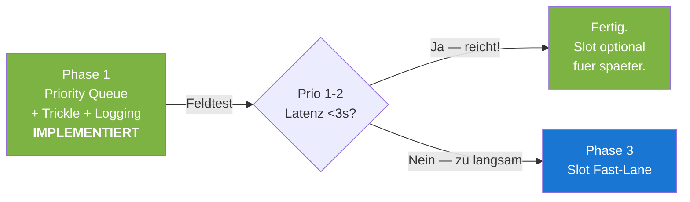

**Status (2026-10):** Phase 1 ist seit v4.35p im Upstream (PR #806-#816) und seither weiterentwickelt (Abschnitt 0). Der Trickle-Feldtest ist gelaufen, eine Prio-Latenz-Auswertung nicht. Die Slot-Fast-Lane ist nicht umgesetzt und müsste vor einer Umsetzung das Kompatibilitätsproblem aus 5.3 lösen.

---

## Anhang A: Betroffene Dateien

### Phase 1 und Folgeänderungen — Stand v4.40a

| Datei                                                                  | Inhalt                                                                                                                                                                                                                                                     |
| ---------------------------------------------------------------------- | ---------------------------------------------------------------------------------------------------------------------------------------------------------------------------------------------------------------------------------------------------------- |
| `src/configuration_global.h`                                           | Prio-Konstanten (`MSG_PRIO_*`), CSMA-Backoff pro Prio (`CSMA_PRIO_BASE_*`, `CSMA_PRIO_SLOTS_*`), Trickle (`TRICKLE_*`), `RING_BG_MAX_AGE_MS`, `PRIO_STAT_INTERVAL_S`/`PRIO_HWM_INTERVAL_S`, `NBR_RELAY_CASE_A_*`                                           |
| `src/txring_functions.cpp/.h`                                          | `getMessagePriority()`, `getNextTxSlot()`, `advanceIReadPastEmpty()`, `addTxRingEntry()` mit Prio-Zuweisung und Prio-Drop, `addTxRingEntryOnce()`, `txRingAgeBackground()`, NBR-Fall A/B (`txringCaseBackoffSlot()`), `txRingDepth()`/`txRingPrioCounts()` |
| `src/lora_functions.cpp/.h`                                            | Prio-Entnahme und Latenz-/Preempt-Tracking in `doTX()`, `csma_compute_timeout_prio()`/`csma_compute_timeout_slot()`, Trickle-Zähler in `OnRxDone()`                                                                                                        |
| `src/hey_policy.h`                                                     | `heyShouldSuppress()`: Trickle-Unterdrückung mit Gateway-Ausnahme                                                                                                                                                                                          |
| `src/loop_functions_extern.h`                                          | Extern-Deklarationen: `ringPriority[]`, `ringEnqueueTime[]`, Trickle-State, Statistik-Variablen                                                                                                                                                            |
| `src/loop_functions.cpp`                                               | Globale Variablen, `sendHey()`, `heyTrickleSuppress()`, `heyGatewayChanged()`, `nbrReportTick()`                                                                                                                                                           |
| `src/esp32/esp32_main.cpp`                                             | Trickle-HEY-Timer, [MC-STAT]/[MC-PRIO]/[MC-HWM]-Ausgabe (5 min/30 min)                                                                                                                                                                                     |
| `src/nrf52/nrf52_main.cpp`                                             | Trickle-HEY-Timer (gleiche Entscheidung wie ESP32, weniger Logging)                                                                                                                                                                                        |
| `src/esp32/loop_actions_esp32.cpp`, `src/nrf52/loop_actions_nrf52.cpp` | Aufruf von `txRingAgeBackground()` im 2-s-Takt                                                                                                                                                                                                             |
| `tools/serial_monitor.py`                                              | Alert `PRIO1_STARVED`, Prio/Trickle-Summary, `RING_DROP_PRIO`-Zähler                                                                                                                                                                                       |
| `tools/loganalyse.sh`                                                  | Sektionen `PRIORITY_DISTRIBUTION`, `TRICKLE_HEY`, `HIGH_WATER_MARKS`                                                                                                                                                                                       |

### Phase 3 — nicht umgesetzt (Entwurf)

| Datei                      | Geplante Aenderung                     |
| -------------------------- | -------------------------------------- |
| `src/aprs_functions.cpp`   | Slot-Byte encode/decode                |
| `src/lora_functions.cpp`   | Slot-Byte TX/RX-Pfad, Superframe-Timer |
| `src/mheard_functions.cpp` | Slot-Info aus Nachbar-Paketen tracken  |

## Anhang B: Referenzen

- Meshtastic Mesh Broadcast Algorithm: https://meshtastic.org/docs/overview/mesh-algo/
- RFC 6206 — The Trickle Algorithm: https://datatracker.ietf.org/doc/html/rfc6206
- TCP-CSMA/CA (Traffic Class Prioritization): PMC 6386877
- CANL LoRa (Collision Avoidance by Neighbor Listening): HAL hal-04191330
- On-Demand LoRa (Asynchronous TDMA): PMC 6263638
- LMAC: Efficient CSMA for LoRa: ACM 3564530
- MeshCom Loganalyse 2026-03-13/14 (Alpine Gateways, Quelle der Zahlen in 2.1; nicht im Repository)

Verwandte Dokumente im Repository:

- `docs/hey-supp.md` — Trickle-HEY-Feldmessung 2026-03-18
- `docs/adr-nc-importance-backoff.md` — ADR-02: Netzwichtigkeits-basierter Relay-Backoff
- `docs/prio-talk-flood-networking.md` — Flood-Networking-Analyse und TX-Pipeline
